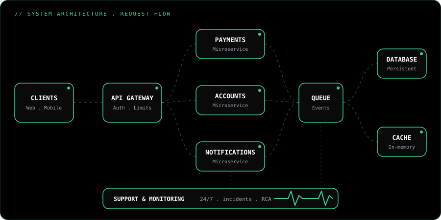

# Deranindu Gunasekara

**Intern System Support Engineer** · Arimac (FinTech)

BSc (Hons) Information Technology, SLIIT (Graduate) · Sri Lanka

[Email](mailto:deranindu@gmail.com) &nbsp;·&nbsp; [Blog](https://codediaryofme.blogspot.com) &nbsp;·&nbsp; [GitHub](https://github.com/DeraniDU)

 

I keep FinTech systems running reliably: monitoring production, handling incidents and tracing root causes. Alongside support work, I'm into backend engineering, cloud and IoT.

*Design for simplicity. Build for scale. Ship for impact.*

 

  

 

deranindu@gmail.com

