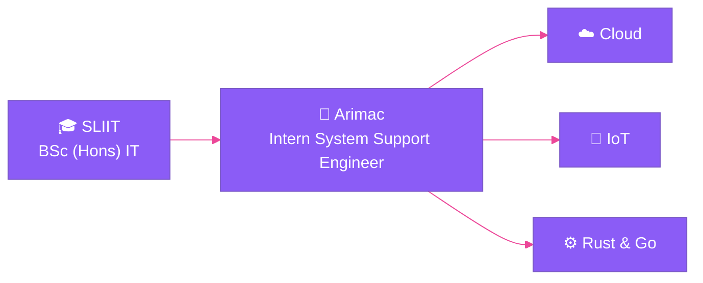

 

 

## ✨ Hello, I'm Deranindu

<table>
<tr>
<td width="62%" valign="top">

I'm an **Intern System Support Engineer at Arimac** 🏦, keeping critical **FinTech** platforms stable, secure and fast. Recently graduated with a **BSc (Hons) in Information Technology from SLIIT** 🎓, I blend **backend engineering**, **cloud** and **IoT** into systems that are built to last.

🔭 **Working on:** production reliability for financial systems 
🌱 **Learning:** Rust · Go · Python · Embedded 
⚡ **Strengths:** scalable APIs · microservices · cloud-native 
📡 **Exploring:** MQTT telemetry · edge computing 
📍 **Based in:** Sri Lanka 🇱🇰

 

> 💬 *"Design for simplicity. Build for scale. Ship for impact."*

</td>
<td width="38%" align="center" valign="middle">

  
  
  

</td>
</tr>
</table>

 

## 🚀 Tech Arsenal

**⚙️ Backend** 

**🗄️ Databases** 

**☁️ Cloud & DevOps** 

**🌱 Currently Exploring** 

 

## 🎯 What I Do

<table>
<tr>
<td align="center" width="25%">

### 🏦
**FinTech Support**

Monitoring, incident response and root-cause analysis for production systems

</td>
<td align="center" width="25%">

### ☁️
**Cloud-Native**

AWS, Kubernetes, Helm and GitOps for scalable deployments

</td>
<td align="center" width="25%">

### 📡
**IoT & Edge**

MQTT telemetry pipelines and real-time device data

</td>
<td align="center" width="25%">

### ⚙️
**Systems**

Rust and Go for performance-critical backends

</td>
</tr>
</table>

 

## 🛤️ My Journey

 

## 📊 GitHub Stats

 

## 💌 Let's Connect

Got an idea, a question, or just want to talk **backend, FinTech, cloud or IoT**?

